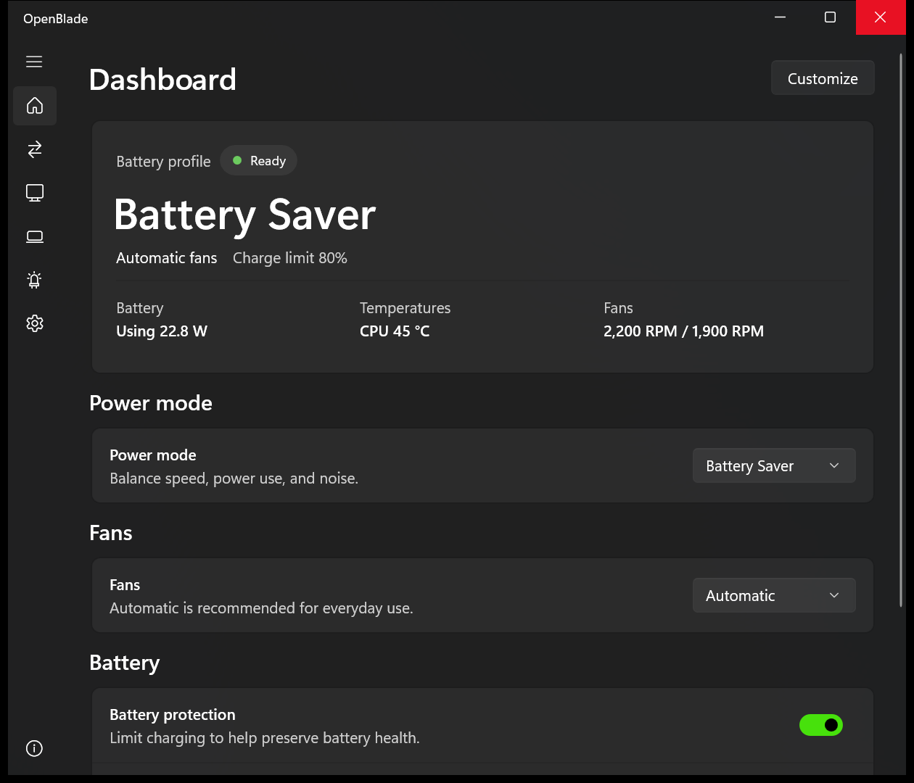
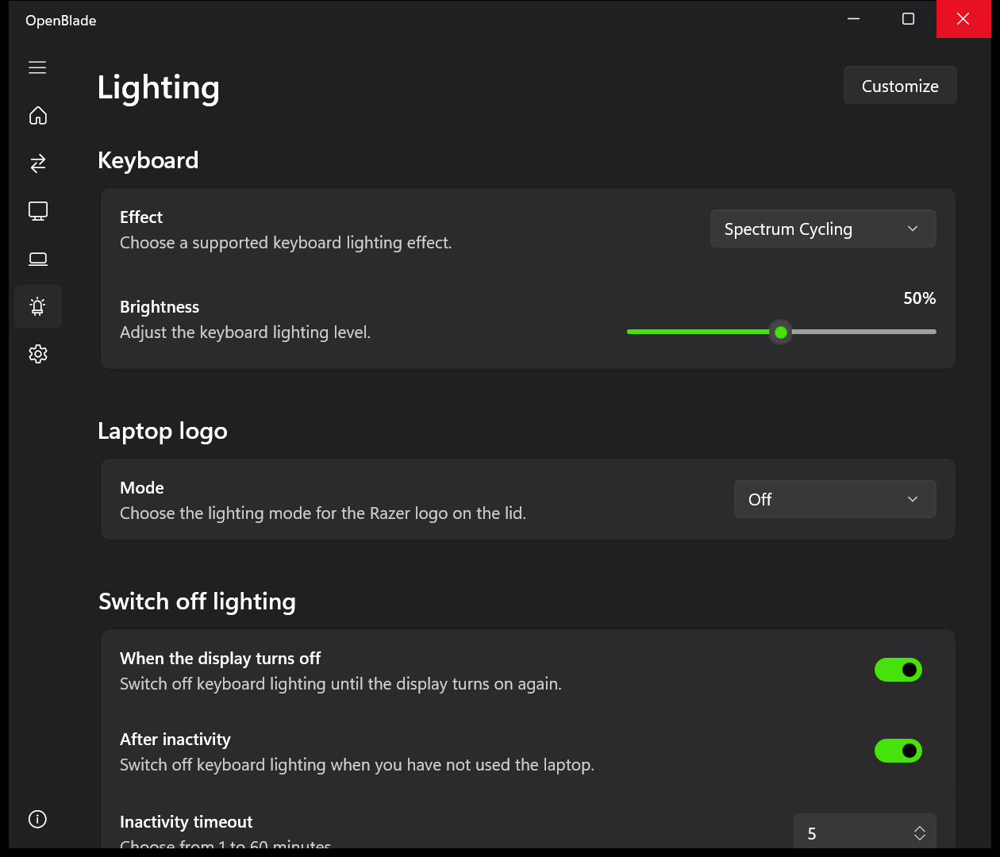
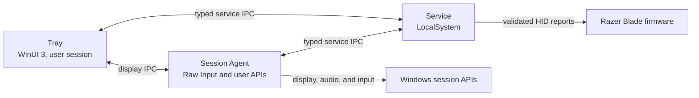

<div align="center">
  
  <h1>OpenBlade</h1>
  <p><strong>Native Windows control for Razer Blade laptops.</strong></p>
  <p>
    <a href="https://github.com/OSSBlade/openblade-docs">Documentation</a>
    ·
    <a href="https://github.com/OSSBlade/openblade-core/releases">Releases</a>
    ·
    <a href="CHANGELOG.md">Changelog</a>
  </p>
</div>

OpenBlade is a tray-first utility for performance, thermals, battery, display
behavior, special keys, and lighting. It runs without Razer Synapse components
and does not install a sensor or control kernel driver.

Hardware support is evidence-based. OpenBlade is Razer-only, and a control is
enabled only when its command has reviewed, sanitized capture evidence for the
exact laptop and firmware.

| Dashboard | Lighting |
| :---: | :---: |
|  |  |

## Current hardware support

| Laptop | USB identity | BIOS | EC | MCU |
| --- | --- | --- | --- | --- |
| Razer Blade 16 (2026), `RZ09-0581` | `1532:02E0` | `3.01`, `4.00` | `1.04` | `1.05`, `1.06` |
| Razer Blade 16 (2025), `RZ09-0528` | `1532:02C6` | `2.02` | `1.09` | `1.09` |

- Unlisted controls and Blade models remain unsupported without equivalent
  capture and restoration evidence

## What it controls

- AC, USB-C, and battery profiles with automatic power-source switching
- Power modes, fan behavior, NVIDIA GPU clock offsets, and battery charge limits
- Keyboard and lid-logo lighting, including streamed effects and a playback
  mute indicator
- Display profiles, brightness behavior, function-row behavior, and M1 through
  M5 Fn-layer bindings
- Battery power and health, fan RPM, CPU temperature, and NVIDIA GPU telemetry
- Optional GitHub release checks with a user-selected startup interval
- Bounded, redacted diagnostics and guided firmware-update smoke tests
- Separate profiles, overrides, display state, and UI preferences for each
  Windows user, backed by one machine-wide service
- Fast User Switching without tray restarts; background trays stay connected
  with user-specific configuration redacted and regain control on switch-back
- A Session Agent for every user, with individual tray startup preferences;
  profile and display automation, configured special keys, and interactive
  lighting continue after tray exit

## Hardware safety

OpenBlade fails closed when identity, evidence, or state cannot be confirmed.

- Only the active physical console user can change hardware. Remote Desktop
  sessions are read-only, and writes fail closed when no console session is
  attached.
- Battery and firmware changes affect the physical laptop regardless of which
  user requests them.
- The LocalSystem service is the only process that owns the laptop control HID
  handle, and it serializes every hardware operation.
- The protocol layer encodes validated 90-byte Razer reports. Service IPC
  exposes typed operations only; there is no raw-command endpoint.
- Every admitted write has a trusted capture fixture. Automatic and stateful
  controls also require independent readback.
- Temporary pipe, enumeration, or read failures preserve the last confirmed UI
  state, but every write performs fresh identity and safety checks.
- Razer software is reported as a possible conflict. OpenBlade does not stop it
  or silently fight external changes.
- [Unexpected service-exit recovery](docs/service-crash-recovery.md) uses the
  bounded SCM policy, observes fresh exact-device state, and resumes only
  eligible OpenBlade-owned producers.

Capture tools are kept outside the installed product, and raw captures are
never production admission artifacts.

## Architecture



| Area | Responsibility |
| --- | --- |
| `OpenBlade.Contracts` | Versioned service IPC, profiles, capabilities, and device state |
| `OpenBlade.Protocol` | Report encoding, fixtures, checksums, admission, and HID transport |
| `OpenBlade.Service` | Hardware ownership, automation, configuration, and named-pipe server |
| `OpenBlade.SessionAgent` | Current-user display, input, audio, and streamed-lighting work |
| `OpenBlade.Tray.Core` / `OpenBlade.Tray` | Presentation policy and the WinUI 3 tray interface |
| `OpenBlade.Setup` | Transactional install, repair, shutdown, and uninstall |
| `OpenBlade.Capture` / `OpenBlade.FirmwareSmoke` | Developer-only protocol and firmware validation |

[AGENTS.md](AGENTS.md) contains the full codebase map and engineering
constraints. [VERSIONING.md](VERSIONING.md) defines product, schema, and IPC
compatibility policy.

## Build and test

You need Windows 11 x64 and the .NET 10 SDK.

```powershell
git submodule update --init --recursive
dotnet restore OpenBlade.slnx -p:NuGetAudit=false
dotnet build OpenBlade.slnx -p:NuGetAudit=false --no-restore
dotnet test OpenBlade.slnx -p:NuGetAudit=false --no-build --no-restore
```

The build treats warnings as errors and uses deterministic assemblies. Tests
cover protocol encoding, device admission, IPC, service behavior, presentation
policy, setup transactions, and release-payload boundaries.

## Publish and install

Create the installer and production artifacts:

```powershell
.\build\Publish.ps1
```

- Graphical installer: `artifacts\win-x64\OpenBlade-Setup.exe`
- Normal installation: double-click the graphical installer; do not use
  **Run as administrator**
- Uninstall: use Windows Settings or the graphical installer; saved profiles
  and preferences remain unless explicitly purged
- Quiet installation: setup does not launch OpenBlade; the caller must start
  `OpenBlade.Tray.exe` from its original normal-integrity process and confirm
  that the Tray and Session Agent are running
- Microsoft Store quiet-install lifecycle remains incomplete until
  [issue #25](https://github.com/OSSBlade/openblade-core/issues/25) is resolved;
  see the [submission notes](docs/microsoft-store-submission.md)

See [build, installation, and Nightly releases](docs/build-install-and-nightly.md)
for development revisions, recovery commands, signing, Store constraints, and
installer troubleshooting.

### Nightly builds

- Built from committed `main` every day at 09:17 UTC or on manual request
- Published as GitHub prereleases with the installer, checksum, metadata, and
  exact-commit changelog snapshot
- Offered in the app only when the **Nightly** update channel is selected
- Test builds, not stable releases; unless release signing is connected, the
  installer is expected to report `NotSigned`
- Verify the installer against its included SHA-256 file

## Hardware development

`OpenBlade.Capture` provides typed target checks, read-only queries, fixture
validation, and explicitly named reversible validation commands. It has no raw
command mode.

```powershell
dotnet run --project src\OpenBlade.Capture -- target
dotnet run --project src\OpenBlade.Capture -- scan
dotnet run --project src\OpenBlade.Capture -- query-fan-rpm
dotnet run --project src\OpenBlade.Capture -- validate path\to\fixtures.json
```

The installed-product firmware workflow starts with a read-only baseline:

```powershell
.\scripts\Test-FirmwareUpdate.ps1 -Phase Baseline
```

Do not run USBPcap and OpenBlade control against the same interface at the same
time. Do not commit raw PCAP files, serial numbers, user paths, or unsanitized
payloads. Capture procedures and restoration requirements are documented in
the separate capture and documentation repositories.

## Keyboard lighting files

Users can write and share data-only `.oblight` presets for effects already
supported by their laptop. The same importer accepts Razer `.chroma` version 1
keyboard files when they reduce exactly to uniform Off or Static lighting. The
versioned format, schema, compatibility rules, and example are in
[`docs/keyboard-lighting-file-format.md`](docs/keyboard-lighting-file-format.md).

## Contributing

Read [AGENTS.md](AGENTS.md) before changing hardware, IPC, setup, or process
boundaries. Keep changes narrow, add focused tests, and run the affected project
tests before the full solution. Hardware support is not complete until its
read/query, apply, readback, and restoration workflow has passed on the exact
target.

Commits follow Conventional Commits. Version and migration rules are in
[VERSIONING.md](VERSIONING.md).

## License

OpenBlade is free software licensed under the
[GNU General Public License version 3 or later](LICENSE)
(`GPL-3.0-or-later`).

## Project repositories

- [openblade-docs](https://github.com/OSSBlade/openblade-docs): user
  documentation and compatibility notes
- [openblade-captures](https://github.com/OSSBlade/openblade-captures):
  sanitized protocol evidence and capture tooling
- [openblade-branding](https://github.com/OSSBlade/openblade-branding): brand
  source files and exports
