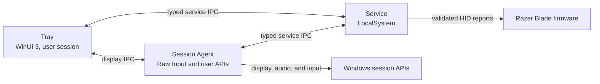

<div align="center">
  
  <h1>OpenBlade</h1>
  <p><strong>Native Windows control for Razer Blade laptops.</strong></p>
  <p>
    <a href="https://github.com/OSSBlade/openblade-docs">Documentation</a>
    ·
    <a href="https://github.com/OSSBlade/openblade-core/releases">Releases</a>
    ·
    <a href="CHANGELOG.md">Changelog</a>
  </p>
</div>

OpenBlade is a tray-first utility for performance, thermals, battery, display
behavior, special keys, and lighting. It runs without Razer Synapse components
and does not install a sensor or control kernel driver.

Hardware support is evidence-based. OpenBlade is Razer-only, and a control is
enabled only when its command has reviewed, sanitized capture evidence for the
exact laptop and firmware.

| Dashboard | Lighting |
| :---: | :---: |
|  |  |

## Current hardware support

| Laptop | USB identity | BIOS | EC | MCU |
| --- | --- | --- | --- | --- |
| Razer Blade 16 (2026), `RZ09-0581` | `1532:02E0` | `3.01` | `1.04` | `1.5.0.0`, `1.6.0.0` |
| Razer Blade 16 (2025), `RZ09-0528` | `1532:02C6` | `2.02` | `1.09` | `1.9.0.0` |

The exact-device `RZ09-0528` admission includes AC performance and custom
levels, fan control, battery care, keyboard brightness and Off, lid-logo
lighting, keyboard behavior, firmware reads, and Windows display controls.
Seven additional Synapse quick effects are shown as observed-only discoveries,
not writable choices, because their exact PID `02C6` captures did not reveal an
effect-specific payload. Other controls and other Blade models remain
unsupported until their commands have equivalent capture and restoration
evidence. OpenBlade does not reuse commands from similar laptops or relax
identity checks to make a device appear compatible.

## What it controls

- AC, USB-C, and battery profiles with automatic power-source switching
- Power modes, fan behavior, NVIDIA GPU clock offsets, and battery charge limits
- Keyboard and lid-logo lighting, including streamed effects and a playback
  mute indicator
- Display profiles, brightness behavior, function-row behavior, and M1 through
  M5 Fn-layer bindings
- Battery power and health, fan RPM, CPU temperature, and NVIDIA GPU telemetry
- Optional GitHub release checks with a user-selected startup interval
- Bounded, redacted diagnostics and guided firmware-update smoke tests

The visible tray can exit without stopping profile automation, display
automation, configured special keys, or interactive lighting. The per-user
Session Agent keeps those features active.

OpenBlade supports multiple Windows users through one machine-wide service.
Each user has separate profiles, overrides, display state, and UI preferences.
Only the currently active interactive Windows session may change the shared
laptop hardware. Fast User Switching keeps background trays connected with
user-specific configuration redacted, then restores control on switch-back
without a tray restart. The Session Agent starts for every user, while tray
startup remains an individual user preference. Battery and firmware changes
still affect the physical laptop, regardless of which user requested them.
Remote Desktop sessions are read-only; hardware control remains with the
physical console session and fails closed when no console session is attached.

## Hardware safety

OpenBlade fails closed when identity, evidence, or state cannot be confirmed.

- The LocalSystem service is the only process that owns the laptop control HID
  handle, and it serializes every hardware operation.
- The protocol layer encodes validated 90-byte Razer reports. Service IPC
  exposes typed operations only; there is no raw-command endpoint.
- Every admitted write has a trusted capture fixture. Automatic and stateful
  controls also require independent readback.
- Temporary pipe, enumeration, or read failures preserve the last confirmed UI
  state, but every write performs fresh identity and safety checks.
- Razer software is reported as a possible conflict. OpenBlade does not stop it
  or silently fight external changes.

Capture tools are kept outside the installed product, and raw captures are
never production admission artifacts.

## Architecture



| Area | Responsibility |
| --- | --- |
| `OpenBlade.Contracts` | Versioned service IPC, profiles, capabilities, and device state |
| `OpenBlade.Protocol` | Report encoding, fixtures, checksums, admission, and HID transport |
| `OpenBlade.Service` | Hardware ownership, automation, configuration, and named-pipe server |
| `OpenBlade.SessionAgent` | Current-user display, input, audio, and streamed-lighting work |
| `OpenBlade.Tray.Core` / `OpenBlade.Tray` | Presentation policy and the WinUI 3 tray interface |
| `OpenBlade.Setup` | Transactional install, repair, shutdown, and uninstall |
| `OpenBlade.Capture` / `OpenBlade.FirmwareSmoke` | Developer-only protocol and firmware validation |

[AGENTS.md](AGENTS.md) contains the full codebase map and engineering
constraints. [VERSIONING.md](VERSIONING.md) defines product, schema, and IPC
compatibility policy.

## Build and test

You need Windows 11 x64 and the .NET 10 SDK.

```powershell
git submodule update --init --recursive
dotnet restore OpenBlade.slnx -p:NuGetAudit=false
dotnet build OpenBlade.slnx -p:NuGetAudit=false --no-restore
dotnet test OpenBlade.slnx -p:NuGetAudit=false --no-build --no-restore
```

The build treats warnings as errors and uses deterministic assemblies. Tests
cover protocol encoding, device admission, IPC, service behavior, presentation
policy, setup transactions, and release-payload boundaries.

## Publish and install

Create the graphical installer, self-contained `win-x64` production bundle,
and separate developer tools:

```powershell
.\build\Publish.ps1
```

The user-facing installer is written to
`artifacts\win-x64\OpenBlade-Setup.exe`. Double-click it and choose Install;
Windows requests administrator approval only when setup is ready to make
system changes. The installer follows the Windows app theme. During install,
repair, or removal, choose **Show details** below the progress bar to see the
files, registry entries, shortcuts, and services being changed. After a
successful install or repair, choose **Launch OpenBlade** to start the Tray;
the Tray starts the Session Agent. In the ordinary
double-click flow, both run in the normal user session. If you explicitly
start the installer with **Run as administrator**, they inherit that elevated
context, so close them and start OpenBlade normally instead.

Quiet installs intentionally suppress both installer UI and application
launch. Automation that invokes `/quiet` must start the installed
`OpenBlade.Tray.exe` from its original normal-integrity process after setup
returns successfully, then confirm that both the Tray and Session Agent are
running. This caller-controlled recovery does not apply to the Microsoft Store
EXE channel, where Partner Center owns the quiet invocation; that remaining
gap is tracked in [issue #25](https://github.com/OSSBlade/openblade-core/issues/25).

The unpacked production bundle remains available at
`artifacts\win-x64\OpenBlade` for development and recovery. Its command-line
setup entry point can be run from an elevated terminal when needed:

```powershell
.\artifacts\win-x64\OpenBlade\OpenBlade.Setup.exe install
```

Uninstall from Windows Settings or rerun the graphical installer. Saved
profiles and preferences are preserved. The standalone command-line setup also
supports `uninstall --purge` for explicitly deleting saved data when it owns
the installation.

If the graphical installer itself is gone but its ownership marker remains,
the standalone payload has one explicit recovery command:

```powershell
.\artifacts\win-x64\OpenBlade\OpenBlade.Setup.exe uninstall --recover-orphaned-bundle
```

Release signing is optional during development. A public signed build supplies
the certificate thumbprint to `Publish.ps1`; the script signs first-party
payload files before WiX embeds them, then signs the detached Burn engine and
the final installer.

The same offline installer is prepared for a future Microsoft Store EXE
listing. Store installs use `/install /quiet /norestart`; direct downloads
retain the graphical UI. The Store caller cannot perform the explicit
normal-integrity relaunch described above, so Store lifecycle support remains
incomplete until [issue #25](https://github.com/OSSBlade/openblade-core/issues/25)
is resolved. See
[Microsoft Store submission](docs/microsoft-store-submission.md) for the
checked-in package contract, certification notes, hardware disclosure, and
remaining external release steps.

### Nightly builds

The `Nightly` GitHub Actions workflow builds the latest committed `main` every
day at 09:17 UTC and can also be started manually. It runs the same formatting,
build, test, authoring, and production-publish gates as CI, retains the Actions
artifact for 14 days, and publishes each successful `main` build as a GitHub
prerelease with its installer, checksum, metadata, and a changelog snapshot
generated from the exact build commit. After publishing, the workflow opens or
updates a draft documentation pull request that records every missing nightly
boundary while preserving newer `Unreleased` entries from `main`.

Nightlies are test builds, not stable releases. They appear on the Releases
page and are offered only when **Nightly** is selected as the in-app update
channel. Verify `OpenBlade-Setup.exe` against the included SHA-256 file. GitHub build
provenance is optional because artifact attestations are not available for
every repository visibility and billing plan. Maintainers can enable the
attestation job by setting the `OPENBLADE_ENABLE_ATTESTATIONS` repository
variable to `true` after confirming support. An enabled attestation can be
checked with:

```powershell
gh attestation verify .\OpenBlade-Setup.exe --repo OSSBlade/openblade-core
```

The included JSON identifies the exact commit, ordered nightly version, build
time, workflow run, installer hash, and Authenticode status. Unless the nightly
workflow is later connected to the protected release-signing certificate, its
installer is expected to report `NotSigned` and Windows may show an
unrecognized-publisher warning.

The changelog update job requires the repository setting **Allow GitHub Actions
to create and approve pull requests**. Its token is scoped to repository
contents and pull requests only in that job. If the setting is disabled, the
nightly release remains published and the failed changelog job can be rerun
after a maintainer enables it. Changelog tally errors are also isolated from
publication: the release attaches the exact source changelog and reports the
tally failure instead of withholding the installer and checksum.

## Hardware development

`OpenBlade.Capture` provides typed target checks, read-only queries, fixture
validation, and explicitly named reversible validation commands. It has no raw
command mode.

```powershell
dotnet run --project src\OpenBlade.Capture -- target
dotnet run --project src\OpenBlade.Capture -- scan
dotnet run --project src\OpenBlade.Capture -- query-fan-rpm
dotnet run --project src\OpenBlade.Capture -- validate path\to\fixtures.json
```

The installed-product firmware workflow starts with a read-only baseline:

```powershell
.\scripts\Test-FirmwareUpdate.ps1 -Phase Baseline
```

Do not run USBPcap and OpenBlade control against the same interface at the same
time. Do not commit raw PCAP files, serial numbers, user paths, or unsanitized
payloads. Capture procedures and restoration requirements are documented in
the separate capture and documentation repositories.

## Contributing

Read [AGENTS.md](AGENTS.md) before changing hardware, IPC, setup, or process
boundaries. Keep changes narrow, add focused tests, and run the affected project
tests before the full solution. Hardware support is not complete until its
read/query, apply, readback, and restoration workflow has passed on the exact
target.

Commits follow Conventional Commits. Version and migration rules are in
[VERSIONING.md](VERSIONING.md).

## License

OpenBlade is free software licensed under the
[GNU General Public License version 3 or later](LICENSE)
(`GPL-3.0-or-later`).

## Project repositories

- [openblade-docs](https://github.com/OSSBlade/openblade-docs): user
  documentation and compatibility notes
- [openblade-captures](https://github.com/OSSBlade/openblade-captures):
  sanitized protocol evidence and capture tooling
- [openblade-branding](https://github.com/OSSBlade/openblade-branding): brand
  source files and exports
