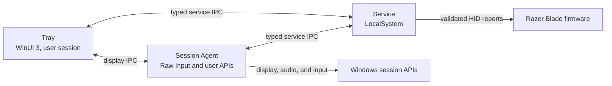

# Developer guide

Use this guide to build, test, and work on OpenBlade. Read
[AGENTS.md](../AGENTS.md)
before changing hardware, IPC, setup, or process boundaries.

For bounded refactor priorities and autonomous delivery criteria, see the
[maintainability roadmap](maintainability-roadmap.md).

## Architecture



| Area | Responsibility |
| --- | --- |
| `OpenBlade.Contracts` | Versioned service IPC, profiles, capabilities, and device state |
| `OpenBlade.Protocol` | Report encoding, fixtures, checksums, admission, and HID transport |
| `OpenBlade.Service` | Hardware ownership, automation, configuration, and named-pipe server |
| `OpenBlade.Session` / `OpenBlade.SessionAgent` | Current-user display, input, audio, and streamed-lighting work |
| `OpenBlade.Display` | Display discovery and Windows refresh rate, HDR, and color profile changes |
| `OpenBlade.Platform` | Windows NVIDIA GPU activity counters, GPU-app cleanup, and processor efficiency policy |
| `OpenBlade.Tray.Core` / `OpenBlade.Tray` | Presentation policy and the WinUI 3 tray interface |
| `OpenBlade.Deployment` | Manifest parsing and signature verification for enrolled local-development deployments |
| `OpenBlade.Setup` | Transactional install, repair, shutdown, and uninstall |
| `OpenBlade.Capture` / `OpenBlade.FirmwareSmoke` | Developer-only protocol and firmware validation |
| `OpenBlade.DeploymentBroker` / `OpenBlade.DeploymentClient` | Local-development installation of locally built payloads, after explicit enrollment |

[AGENTS.md](../AGENTS.md) contains the full codebase map and engineering
constraints. [VERSIONING.md](../VERSIONING.md) defines product, schema, and IPC
compatibility policy.

## Hardware safety model

OpenBlade fails closed when identity, evidence, or state cannot be confirmed.

- Only the active physical console user can change hardware. Remote Desktop
  sessions are read-only, and writes fail closed when no console session is
  attached.
- Battery and firmware changes affect the physical laptop regardless of which
  user requests them.
- The LocalSystem service is the only process that owns the laptop control HID
  handle, and it serializes every hardware operation.
- The protocol layer encodes validated 90-byte Razer reports. Service IPC
  exposes typed operations only; there is no raw-command endpoint.
- Physically validated writes retain their captured command and confirmation
  contracts. Experimental setters use separately reviewed, pinned upstream
  definitions with decoded baselines and independent readback. Both retain fresh
  exact-device and controller checks.
- Temporary pipe, enumeration, or read failures preserve the last confirmed UI
  state, but every write performs fresh identity and safety checks.
- Competing Razer controllers block affected operations. Verified
  [Synapse Blade Blocker](synapse-blade-blocker.md) installations can coexist
  with OpenBlade. OpenBlade never stops other controllers automatically.
- [Unexpected service-exit recovery](service-crash-recovery.md) uses the
  bounded SCM policy, observes fresh exact-device state, and resumes only
  eligible OpenBlade-owned producers.

Production admission is scoped to the exact Razer product name and HID identity.
The service reads the BIOS manufacturer and product name to choose which
admitted model to verify, then checks only that model's exact identity. SKU and
BIOS version are optional diagnostic metadata: configuration variants are not
rejected by SKU, and a missing, unreadable, or disagreeing BIOS version does not
block admission. Hardware-specific backends retain their own device and driver
checks. BIOS, EC, and MCU
versions remain evidence provenance: no shipped capability is restricted to a
firmware version, so an untested BIOS is admitted and reported as model-scoped.
Only an identity that explicitly pins exact versions checks SKU and BIOS
version. Capture tools are kept outside the installed product, may pin an exact
BIOS version for reproducibility, and raw captures are never production
admission artifacts.

Experimental profiles are recognized automatically by `ExperimentalBladeFactory`
and use `ExperimentalBladePort` with their own bounded capabilities and source
provenance. They have no Settings consent switch or release-channel gate.
Pre-releases are the testing route, not a new hardware-admission rule. The
[experimental support guide](experimental-blade-support.md) lists the five exact
models and remaining physical validation. Recognizing a profile does not promote
its controls to capture-backed support or admit manual fan commands, host-rendered
lighting, or another model's brightness driver.

When an admitted laptop's exact Razer driver stack is already present,
OpenBlade can use it for the native Windows brightness flyout. RZ09-0581 and
RZ09-0528 have separate, model-specific stacks. WMI remains the fallback. See
the [Razer driver package notes](razer-brightness-driver-package.md) for the
validation and redistribution limits.

## Diagnostics exports

Use **Export diagnostics** in the tray to collect device-verification evidence.
The ZIP's `device-verification.json` contains the latest service probe and the
most recent failure from the current service run, with timestamps. A successful
probe after recovery does not erase the earlier failure.

Each attempt records its stage, classification, and a readable reason. Host
identity failures identify the failed platform or registry check and its
expected and observed values. `observedSku` retains available SKU metadata after
host admission. HID failures include candidate-open errors and
identity-match counters. `usedRecentlyVerifiedDevice` shows when the service
preserved a recently verified device through a transient probe failure.

Export reads cached evidence without probing hardware again. Before the first
probe, both attempts are `null`. Identity values use the export's sensitive-token
redaction; exception evidence contains only the type and error code. Device
paths, serial numbers, exception messages, and raw HID reports are not collected
by this verification record. The USB IDs in `device.json` identify the catalog
model and do not establish successful HID verification.

When the latest probe read a BIOS manufacturer or product name that matches
neither the physically validated nor experimental exact-model catalogs, the service status sets `UnsupportedLaptop`. Registry read
failures, platform failures, firmware blocks, and failed checks on an admitted
model leave it false. The tray then
shows **This laptop isn't supported yet** with **Help add support**. That action
uses the same export, keeps only `versions.json` and `device-verification.json`,
saves them as `OpenBlade-identity-report.zip` without tray logs, and opens the
[Synapse Observer guide](https://github.com/OpenBladeProject/synapse-observer).
The guide explains collection and submission to an existing or new model-support
request. `device.json` is left out because it has a serial-number field.

If device controls are disabled after identity verification succeeds, check
`configuration.json`'s `status.message` and `command-results.json`. Protocol
failures identify the rejected battery or thermal query and its validation
category. Thermal diagnostics distinguish each channel from channel agreement
and custom CPU/GPU settings.

`firmware-queries.json` retains results from supported firmware state queries
on validated and experimental models. Each query and selector has its own
latest observation, first and last failure, and last failure with a reply.
Successful recovery, port disposal and ordinary log rotation do not erase
that failure evidence. The collection lasts for the current service run;
export before restarting the service.

Replies are exported as bounded hexadecimal payloads after envelope,
correlation, status and length validation. Decoder and exact-model admission
rejections retain those payloads, including unrecognized adapter replies.
Transport and framing failures retain typed failure details instead of an
untrusted response. Serial queries, device paths and full HID reports are
excluded. Exporting makes no additional hardware requests and does not change
write admission.

For adapter classification, use the [pinned Synapse wattage definitions](synapse-adapter-wattage.md)
first. The reply contains both connected and recommended wattage; insufficient
power does not identify a connector. Use retained diagnostics when vendor data
is missing or a device's reply does not match it.

Experimental devices also export `experimental-support.json` with source
provenance, write-pause state, and the last 32 typed command-stage observations,
alongside cached telemetry. Exports remain local until a user shares them.
Collect diagnostics before choosing **Resume experimental controls**. Recovery
drains the old session, rechecks identity and authority, then reads and reconciles
current state without sending a setter or replaying the uncertain request. A new
lighting choice releases the old lighting hold; unrelated profile edits do not.
See the [tester workflow](experimental-blade-support.md#send-a-useful-test-report)
for baseline and follow-up reports.

## Build and test

You need Windows 11 x64 and the .NET 10 SDK.

```powershell
git submodule update --init --recursive
dotnet restore OpenBlade.slnx -p:NuGetAudit=false
dotnet build OpenBlade.slnx -p:NuGetAudit=false --no-restore
dotnet test OpenBlade.slnx -p:NuGetAudit=false --no-build --no-restore
```

The build treats warnings as errors and uses deterministic assemblies. Tests
cover protocol encoding, device admission, IPC, service behavior, presentation
policy, setup transactions, and release-payload boundaries.

## Publish and install

Create the installer and production artifacts:

```powershell
.\build\Publish.ps1
```

- Graphical installer: `artifacts\win-x64\OpenBlade-Setup.exe`
- Normal installation: double-click the graphical installer; do not use
  **Run as administrator**
- Uninstall: use Windows Settings or the graphical installer; saved profiles
  and preferences remain unless explicitly purged
- Quiet installation: setup does not launch OpenBlade; the caller must start
  `OpenBlade.Tray.exe` from its original normal-integrity process and confirm
  that the Tray and Session Agent are running
- Microsoft Store quiet-install lifecycle remains incomplete until
  [issue #25](https://github.com/OSSBlade/openblade-core/issues/25) is resolved;
  see the [submission notes](microsoft-store-submission.md)

See [build, installation, and Nightly releases](build-install-and-nightly.md)
for development revisions, recovery commands, signing, Store constraints, and
installer troubleshooting.

### Nightly builds

- Built from committed `main` only when a maintainer starts the workflow manually
- Prepared as draft GitHub prereleases with the installer, checksum, metadata,
  and exact-commit changelog snapshot
- Published after the generated changelog PR is reviewed and merged, then
  **Finalize Nightly** is run on `main` with the draft's exact tag; see the
  [Nightly workflow](build-install-and-nightly.md)
- Offered in the app only when the **Nightly** update channel is selected
- Test builds, not stable releases; unless release signing is connected, the
  installer is expected to report `NotSigned`
- Verify the installer against its included SHA-256 file

## Hardware development

`OpenBlade.Capture` provides typed target checks, read-only queries, fixture
validation, and explicitly named reversible validation commands. It has no raw
command mode.

```powershell
dotnet run --project src\OpenBlade.Capture -- target
dotnet run --project src\OpenBlade.Capture -- scan
dotnet run --project src\OpenBlade.Capture -- query-fan-rpm
dotnet run --project src\OpenBlade.Capture -- validate path\to\fixtures.json
```

### Power Mode Control and local dimming

`07/8F` (get) and `07/0F` (set) are Synapse's Power Mode Control, a shared
bitmask:

| Bit | Meaning |
|---|---|
| `0x01` | CPU boost |
| `0x02` | Max fan speed |
| `0x04` | One-time full charge ("Allow system to fully charge once") |
| `0x08` | Local dimming |

A read-only inspection of the installed Synapse 4 code found this reply decoder
in Synapse's shared Blade device code (`rzDevice25`), not only in RZ09-0581
code. Synapse changes one bit at a time with read-modify-write. In the inspected
code, its local dimming action writes `0x08` on Blade series 10 to 12 and
toggles Windows HDR on other series. Captured evidence covers less: the
RZ09-0581 shows `00`, `04` and `08` in the field and in local tests, while the
RZ09-0528 captures show only `00` and `04`. The other bit meanings come from
Synapse's code, not captures.

On the RZ09-0581, Synapse follows Windows HDR while it runs: turning HDR on sets
`0x08`, turning it off clears it, and the bit stays set after Synapse exits.
This happens even though the OLED panel has no local dimming hardware. Evidence
is in
[firmware-validation-rz09-0581-mcu-1.7.md](firmware-validation-rz09-0581-mcu-1.7.md).

Because the decoder is shared, OpenBlade applies the same rules to every model
that reads `07/8F` or writes `07/0F`, in production and in developer validation
runs:

- Any one-byte value made of the four bits decodes, and temporary full charge is
  bit `0x04`. Undefined bits (`0x10` to `0x80`) and other lengths are rejected,
  and the rejected bytes stay in diagnostics.
- Before every `07/0F` write, a fresh `07/8F` read in the same write session must
  be `00` or `04`. Otherwise nothing is sent. In the product, the result names
  the settings that are on. The developer validation run reports the refusal
  as `EnableFailed` or `CancelFailed`, although nothing was sent. OpenBlade has
  captured only the bare `00` and `04` writes.
- This does not add `07/8F` or `07/0F` to any model. The experimental backend
  does not use them.

When you admit a model, check its panel:

- **OLED, or no local dimming hardware** (the RZ09-0581 today): don't offer a
  local dimming control. Read `0x08` and leave it untouched.
- **Mini-LED with local dimming**: offer an explicit **Clear** action, shown
  only while `0x08` is set. Use the captured payloads: write `00`, or `04` when
  full charge is on, so only `0x08` changes. Confirm by readback, and refuse if
  `0x01` or `0x02` is set. Gate it on that model's exact identity and panel
  evidence, for example its mini-LED resolution reading. Don't clear the bit
  automatically, since it may be a real display setting. Any other combined
  payload needs capture and reversible validation first.

### RZ09-0581 lighting cadence validator

The RZ09-0581 cadence validator measures whether the admitted `1532:02E0`
matrix transport can sustain progressive 30, 45, and 60 Hz writes. Stop the
OpenBlade service first, substitute the laptop's admitted BIOS version, and
choose a directory for the sanitized timestamped JSON and Markdown results:

```powershell
dotnet run --project src\OpenBlade.Capture -- `
  validate-rz09-0581-lighting-cadence `
  --confirm-target RZ09-0581:1532:02E0:4.00:000C:0001:375 `
  --rates 30,45,60 --pattern tidal --brightness 100 --seconds 15 `
  --output .\lighting-cadence-results
```

`--rates 30,45,60` is an exact, ordered confirmation of the fixed validation
plan; subsets, reordering, and other rates are rejected before hardware opens.

Choose `marker` for a Spectrum base with a 12-bit per-frame counter suitable
for high-speed video, or `tidal` for the captured five-second green/blue Tidal
motion used for direct operator comparison across the three rates.

The run replaces the current keyboard effect. That unknown pre-test effect
cannot be read or restored; a healthy run finishes at the explicitly confirmed
Static green baseline.

This validates host-to-keyboard transport completion and records operator
confirmation of visible stability. It does not measure the LEDs' exact optical
refresh rate. Each stage also records the validator process's CPU time across
the measured window. Developer-only phase timing splits each successful
end-to-end write into queue wait, the strict competing-controller check, native
submit-to-completion, managed completion handling, and residual host work. The
frame-budget p99 gate excludes only the strict validator guard when every
completed frame has exactly one aligned, nonnegative phase attribution.
Completion ratio and maximum gap are independent end-to-end gates; achieved
rate and skipped-frame count remain end-to-end diagnostics reflected in
completion. Any missing, extra, or over-attributed phase timing disables guard
subtraction and falls back to complete end-to-end write timing.
The validator retains strict per-write controller checks throughout each stage;
it does not switch to the production Advisory policy during measurement.

`singleLogicalProcessorPercent` treats one fully occupied
logical processor as 100%; `wholeMachineCapacityPercent` divides that value by
the recorded logical-processor count, matching Task Manager's process-wide
normalization. Near each deadline, the developer tool uses a process-local
precision wait instead of changing the Windows timer period, so its CPU result
measures the validator's intentional spin-wait cost rather than the installed
service's `Task.Delay` scheduler. If a write outcome is indeterminate, the
validator stops without retrying or restoring lighting and reports that manual
recovery is required.

### Firmware-update smoke workflow

Recorded validation: [RZ09-0581 MCU 1.7.0.0](firmware-validation-rz09-0581-mcu-1.7.md).

The installed-product firmware workflow starts with a read-only baseline:

```powershell
.\scripts\Test-FirmwareUpdate.ps1 -Phase Baseline
```

Do not run USBPcap and OpenBlade control against the same interface at the same
time. Do not commit raw PCAP files, serial numbers, user paths, or unsanitized
payloads. Capture procedures and restoration requirements are documented in
the separate capture and documentation repositories.

## Keyboard lighting file format

Users can write and share data-only `.oblight` presets for effects already
supported by their laptop. The same importer accepts Razer `.chroma` version 1
keyboard files. Uniform files convert losslessly; classic Keyboard per-key
animations use a bounded, exact-model logical-key projection on the verified
RZ09-0581 and RZ09-0528 layouts. Unsupported colored cells are reported, and
per-key KeyboardExtended files are rejected instead of cropped. Enable **Lab
features** in Settings to show the importer. The versioned format, schema,
compatibility rules, and example are in
[`keyboard-lighting-file-format.md`](keyboard-lighting-file-format.md).

## Contributing

CI selects affected builds, tests, and contract checks for pull requests and
pushes to main. Draft and ready pull requests use the same rules. Known test
project files select their owning suite; production project metadata, shared
build inputs, and unknown changes require full validation. Installer and Store
checks run when packaging or its dependencies are affected.

Manual CI runs and the weekly Sunday run at 00:00 UTC validate the full solution,
build contracts, and installer. Release builds also retain full validation.
The weekly run uses a separate concurrency group so a main push cannot cancel it.

Keep changes narrow, add focused tests, and run the affected project tests
before the full solution. Hardware support is not complete until its
read/query, apply, readback, and restoration workflow has passed on the exact
target.

Commits follow Conventional Commits. Version and migration rules are in
[VERSIONING.md](../VERSIONING.md). Resource keys, fallback behavior, and the
pseudo-localization review workflow are in [localization.md](localization.md).
