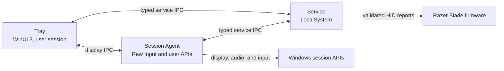

# Developer guide

This page collects the build, publish, and hardware-development material that
used to live in the main [README](../README.md). Read [AGENTS.md](../AGENTS.md)
before changing hardware, IPC, setup, or process boundaries.

## Architecture



| Area | Responsibility |
| --- | --- |
| `OpenBlade.Contracts` | Versioned service IPC, profiles, capabilities, and device state |
| `OpenBlade.Protocol` | Report encoding, fixtures, checksums, admission, and HID transport |
| `OpenBlade.Service` | Hardware ownership, automation, configuration, and named-pipe server |
| `OpenBlade.Session` / `OpenBlade.SessionAgent` | Current-user display, input, audio, and streamed-lighting work |
| `OpenBlade.Display` | Display discovery and Windows refresh rate, HDR, and color profile changes |
| `OpenBlade.Platform` | Windows NVIDIA GPU activity counters, GPU-app cleanup, and processor efficiency policy |
| `OpenBlade.Tray.Core` / `OpenBlade.Tray` | Presentation policy and the WinUI 3 tray interface |
| `OpenBlade.Deployment` | Release manifest parsing and signed-release verification for update checks |
| `OpenBlade.Setup` | Transactional install, repair, shutdown, and uninstall |
| `OpenBlade.Capture` / `OpenBlade.FirmwareSmoke` | Developer-only protocol and firmware validation |
| `OpenBlade.DeploymentBroker` / `OpenBlade.DeploymentClient` | Local-development installation of locally built payloads, after explicit enrollment |

[AGENTS.md](../AGENTS.md) contains the full codebase map and engineering
constraints. [VERSIONING.md](../VERSIONING.md) defines product, schema, and IPC
compatibility policy.

## Hardware safety model

OpenBlade fails closed when identity, evidence, or state cannot be confirmed.

- Only the active physical console user can change hardware. Remote Desktop
  sessions are read-only, and writes fail closed when no console session is
  attached.
- Battery and firmware changes affect the physical laptop regardless of which
  user requests them.
- The LocalSystem service is the only process that owns the laptop control HID
  handle, and it serializes every hardware operation.
- The protocol layer encodes validated 90-byte Razer reports. Service IPC
  exposes typed operations only; there is no raw-command endpoint.
- Every admitted write has a trusted capture fixture. Automatic and stateful
  controls also require independent readback.
- Temporary pipe, enumeration, or read failures preserve the last confirmed UI
  state, but every write performs fresh identity and safety checks.
- Razer software is reported as a possible conflict. OpenBlade does not stop it
  on its own or silently fight external changes.
- [Unexpected service-exit recovery](service-crash-recovery.md) uses the
  bounded SCM policy, observes fresh exact-device state, and resumes only
  eligible OpenBlade-owned producers.

BIOS versions remain evidence provenance unless a capability has an explicit
firmware-specific restriction. Capture tools are kept outside the installed
product, and raw captures are never production admission artifacts.

When the exact admitted RZ09-0581 Razer driver stack is already present,
OpenBlade can use it for the native Windows brightness flyout. WMI remains the
fallback. See the [Razer driver package notes](razer-brightness-driver-package.md)
for the model, validation, and redistribution limits.

## Build and test

You need Windows 11 x64 and the .NET 10 SDK.

```powershell
git submodule update --init --recursive
dotnet restore OpenBlade.slnx -p:NuGetAudit=false
dotnet build OpenBlade.slnx -p:NuGetAudit=false --no-restore
dotnet test OpenBlade.slnx -p:NuGetAudit=false --no-build --no-restore
```

The build treats warnings as errors and uses deterministic assemblies. Tests
cover protocol encoding, device admission, IPC, service behavior, presentation
policy, setup transactions, and release-payload boundaries.

## Publish and install

Create the installer and production artifacts:

```powershell
.\build\Publish.ps1
```

- Graphical installer: `artifacts\win-x64\OpenBlade-Setup.exe`
- Normal installation: double-click the graphical installer; do not use
  **Run as administrator**
- Uninstall: use Windows Settings or the graphical installer; saved profiles
  and preferences remain unless explicitly purged
- Quiet installation: setup does not launch OpenBlade; the caller must start
  `OpenBlade.Tray.exe` from its original normal-integrity process and confirm
  that the Tray and Session Agent are running
- Microsoft Store quiet-install lifecycle remains incomplete until
  [issue #25](https://github.com/OSSBlade/openblade-core/issues/25) is resolved;
  see the [submission notes](microsoft-store-submission.md)

See [build, installation, and Nightly releases](build-install-and-nightly.md)
for development revisions, recovery commands, signing, Store constraints, and
installer troubleshooting.

### Nightly builds

- Built from committed `main` every day at 09:17 UTC or on manual request
- Published as GitHub prereleases with the installer, checksum, metadata, and
  exact-commit changelog snapshot
- Offered in the app only when the **Nightly** update channel is selected
- Test builds, not stable releases; unless release signing is connected, the
  installer is expected to report `NotSigned`
- Verify the installer against its included SHA-256 file

## Hardware development

`OpenBlade.Capture` provides typed target checks, read-only queries, fixture
validation, and explicitly named reversible validation commands. It has no raw
command mode.

```powershell
dotnet run --project src\OpenBlade.Capture -- target
dotnet run --project src\OpenBlade.Capture -- scan
dotnet run --project src\OpenBlade.Capture -- query-fan-rpm
dotnet run --project src\OpenBlade.Capture -- validate path\to\fixtures.json
```

### RZ09-0581 lighting cadence validator

The RZ09-0581 cadence validator measures whether the admitted `1532:02E0`
matrix transport can sustain progressive 30, 45, and 60 Hz writes. Stop the
OpenBlade service first, substitute the laptop's admitted BIOS version, and
choose a directory for the sanitized timestamped JSON and Markdown results:

```powershell
dotnet run --project src\OpenBlade.Capture -- `
  validate-rz09-0581-lighting-cadence `
  --confirm-target RZ09-0581:1532:02E0:4.00:000C:0001:375 `
  --rates 30,45,60 --pattern tidal --brightness 100 --seconds 15 `
  --output .\lighting-cadence-results
```

`--rates 30,45,60` is an exact, ordered confirmation of the fixed validation
plan; subsets, reordering, and other rates are rejected before hardware opens.

Choose `marker` for a Spectrum base with a 12-bit per-frame counter suitable
for high-speed video, or `tidal` for the captured five-second green/blue Tidal
motion used for direct operator comparison across the three rates.

The run replaces the current keyboard effect. That unknown pre-test effect
cannot be read or restored; a healthy run finishes at the explicitly confirmed
Static green baseline.

This validates host-to-keyboard transport completion and records operator
confirmation of visible stability. It does not measure the LEDs' exact optical
refresh rate. Each stage also records the validator process's CPU time across
the measured window. Developer-only phase timing splits each successful
end-to-end write into queue wait, the strict competing-controller check, native
submit-to-completion, managed completion handling, and residual host work. The
frame-budget p99 gate excludes only the strict validator guard when every
completed frame has exactly one aligned, nonnegative phase attribution.
Completion ratio and maximum gap are independent end-to-end gates; achieved
rate and skipped-frame count remain end-to-end diagnostics reflected in
completion. Any missing, extra, or over-attributed phase timing disables guard
subtraction and falls back to complete end-to-end write timing.
The validator retains strict per-write controller checks throughout each stage;
it does not switch to the production Advisory policy during measurement.

`singleLogicalProcessorPercent` treats one fully occupied
logical processor as 100%; `wholeMachineCapacityPercent` divides that value by
the recorded logical-processor count, matching Task Manager's process-wide
normalization. Near each deadline, the developer tool uses a process-local
precision wait instead of changing the Windows timer period, so its CPU result
measures the validator's intentional spin-wait cost rather than the installed
service's `Task.Delay` scheduler. If a write outcome is indeterminate, the
validator stops without retrying or restoring lighting and reports that manual
recovery is required.

### Firmware-update smoke workflow

The installed-product firmware workflow starts with a read-only baseline:

```powershell
.\scripts\Test-FirmwareUpdate.ps1 -Phase Baseline
```

Do not run USBPcap and OpenBlade control against the same interface at the same
time. Do not commit raw PCAP files, serial numbers, user paths, or unsanitized
payloads. Capture procedures and restoration requirements are documented in
the separate capture and documentation repositories.

## Keyboard lighting file format

Users can write and share data-only `.oblight` presets for effects already
supported by their laptop. The same importer accepts Razer `.chroma` version 1
keyboard files. Uniform files convert losslessly; classic Keyboard per-key
animations use a bounded, exact-model logical-key projection on the verified
RZ09-0581 and RZ09-0528 layouts. Unsupported colored cells are reported, and
per-key KeyboardExtended files are rejected instead of cropped. Enable **Lab
features** in Settings to show the importer. The versioned format, schema,
compatibility rules, and example are in
[`keyboard-lighting-file-format.md`](keyboard-lighting-file-format.md).

## Contributing

Keep changes narrow, add focused tests, and run the affected project tests
before the full solution. Hardware support is not complete until its
read/query, apply, readback, and restoration workflow has passed on the exact
target.

Commits follow Conventional Commits. Version and migration rules are in
[VERSIONING.md](../VERSIONING.md). Resource keys, fallback behavior, and the
pseudo-localization review workflow are in [localization.md](localization.md).
